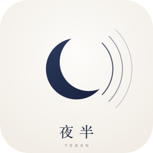
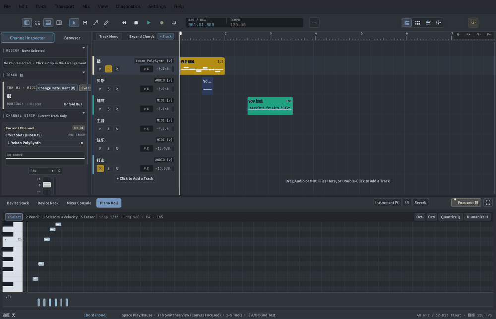

<p align="center">
  <picture>
    <source media="(prefers-color-scheme: dark)" srcset="assets/brand/png/yeban-dark-256.png">
    <source media="(prefers-color-scheme: light)" srcset="assets/brand/png/yeban-light-256.png">
    
  </picture>
</p>

<p align="center">
  <strong>English</strong> · <a href="README.zh-CN.md">简体中文</a>
  &nbsp;|&nbsp;
  <a href="https://yeban.wangda.today">Website</a> ·
  <a href="docs/README.md">Documentation index</a>
</p>

---

# 夜半 (Yeban) — a professional desktop DAW

Yeban is an open-source digital audio workstation written in Rust: a Slint native GUI on top of a pure-Rust, low-latency real-time audio engine. It ships with a complete MCP tool surface, so AI agents can compose, arrange and mix through it, side by side with the human at the desktop GUI.

**Licence**: GNU General Public License v3.0 (GPLv3), with the GPLv3 §7 additional permission for loading proprietary CLAP plug-ins. See [Legal](#legal).

## Download

Installers from the rolling **nightly** build (tracks the `main` branch; unsigned):

| Platform | Installer |
| :--- | :--- |
| Windows (x86_64) | [MSI installer](https://github.com/gradetwo/yeban/releases/download/nightly/yeban-0.0.1-x86_64-pc-windows-msvc.msi) |
| macOS (Apple Silicon) | [DMG image](https://github.com/gradetwo/yeban/releases/download/nightly/yeban-0.0.1-aarch64-apple-darwin.dmg) |
| macOS (Intel) | [DMG image](https://github.com/gradetwo/yeban/releases/download/nightly/yeban-0.0.1-x86_64-apple-darwin.dmg) |
| Linux (x86_64) | [DEB package](https://github.com/gradetwo/yeban/releases/download/nightly/yeban-0.0.1-x86_64-unknown-linux-gnu.deb) |
| Linux (arm64) | [DEB package](https://github.com/gradetwo/yeban/releases/download/nightly/yeban-0.0.1-aarch64-unknown-linux-gnu.deb) |

Portable `.tar.gz` archives and `SHA256SUMS` are on the [nightly release page](https://github.com/gradetwo/yeban/releases/tag/nightly); all releases are listed under [Releases](https://github.com/gradetwo/yeban/releases).

## Screenshots

The current interface, running the built-in demo project (drums, bass, pad, lead, strings, percussion):

[](https://yeban.wangda.today/#interface)

## What Yeban can do

- **Songmap — whole-song overview** (`get_song_overview` MCP tool, or `--export-song-overview` on the CLI): one bar-level diagnostic in four layers — energy, frequency, density and emotion — with an automatic anomaly summary, expected-level envelope bands, three genre presets (`default` / `orchestral` / `electronic`), a score-dynamics ghost line, an A/B snapshot diff (`compare_song_snapshots` MCP tool) and a within-song self-similarity check.
- **Mastering from the command line**: `--loudness-target` with `--true-peak-ceiling` applies the loudness target on `--export-wav`; an unreachable target fails loudly instead of silently degrading.
- **Batch edits and stems**: `--apply-ops` commits a file of edit operations as one batch; `--export-stems` renders stems with the same backend as the MCP tool.
- **Sample-library editor**: `--edit-samples` corrects each sample's pitch to within ±0.5 cents (FFT fundamental), synthesises mf/f velocity layers and normalises RMS.
- **Audio slicer**: `--slice-audio` detects onsets, cuts audio into syllables, shifts / stretches / tape-varispeeds them and writes SFZ sampler regions.
- **Lyrics track**: `--export-lyrics` stores a lyrics timeline in the project and exports LRC.
- **Projects carry what they use**: used samples and their SFZ definitions are embedded in the `.yeban` container; rendering checks the embedded pool first, disk second; old projects render unchanged.
- **Native presets**: four MCP tools (`yeban_list_presets`, `yeban_apply_preset`, `yeban_save_preset`, `yeban_preset_bypass`) and six factory presets (piano, cello, classical guitar, flute, saxophone, drums) that load with tuned processing instead of a dry sound.
- **Singing synthesis, via the external SVS service**: `synthesize_singing` submits a score and `svs_job` polls it back — Yeban is the MCP client; synthesis itself runs in the Lingren SVS service.
- **46 MCP tools** (Intent API v2) and a **VST3 plug-in host** (in-process; cross-process isolation is phase 2).

## Status and platform support

Yeban is in active development. The engine renders audio deterministically; the app still starts with a demo project, and there is no MPE yet. The roadmap is in [docs/YEBAN_ENGINEERING_IMPLEMENTATION_ROADMAP.md](docs/YEBAN_ENGINEERING_IMPLEMENTATION_ROADMAP.md).

macOS, Linux and Windows are all fully tested. The UI layer is still being refined.

### Windows console encoding

Yeban's command-line output is UTF-8. The default Windows console code page can render it as mojibake, so run `chcp 65001` in the console first to switch the code page to UTF-8 before running Yeban commands.

## Build from source

You need Rust 1.99.0 (pinned by [`rust-toolchain.toml`](rust-toolchain.toml); `rustup` installs it automatically), a C++ compiler, and `libclang` (the `yeban-dsp` build generates bindings with `bindgen`).

**Linux (Debian/Ubuntu)**

```bash
sudo apt-get install -y clang libclang-dev pkg-config libfontconfig1-dev libfreetype-dev libxkbcommon-dev libxkbcommon-x11-0 libwayland-dev libx11-dev libgl1-mesa-dev libasound2-dev
git clone https://github.com/gradetwo/yeban.git
cd yeban
cargo build --release -p yeban-app
```

**macOS**

```bash
xcode-select --install
git clone https://github.com/gradetwo/yeban.git
cd yeban
cargo build --release -p yeban-app
```

**Windows**

Install LLVM and set `LIBCLANG_PATH` to the directory that contains `libclang.dll`, then:

```bat
git clone https://github.com/gradetwo/yeban.git
cd yeban
cargo build --release -p yeban-app
```

Run it with `cargo run --release -p yeban-app` (add `-- --headless` on a machine without a display). On a memory-tight machine, build with `cargo build --profile release-small -p yeban-app` instead. The full command-line reference (`--help` lists every switch and exit code), the MCP server modes and the development workflow are in the [documentation index](docs/README.md).

## Made with Yeban

**[《慢性崩溃环 THE CHRONIC MOBIUS》](https://trilogy.wangda.today)** — a trilogy created with Yeban. Three chapters — I. 雨声太吵 (The Rain Is Too Loud), II. 失语呢喃， III. 潮·失 — in one immersive visual experience: click the topology nodes to jump between emotional phases.

▶ Listen to 《雨声太吵》 (4:24, [direct audio](https://trilogy.wangda.today/assets/05-yushengtaichao.mp3)) — the full experience, visuals synced to the music, is on [the trilogy site](https://trilogy.wangda.today).

## Legal

| File | Contents |
| :--- | :--- |
| [`LICENSE`](LICENSE) | GNU GPLv3 full text with the GPLv3 §7 CLAP plug-in exception |
| [`LEGAL.md`](LEGAL.md) | Third-party trademark disclaimers, Slint dual-licensing, VST3 SDK MIT path, asset policy |
| [`TRADEMARK.md`](TRADEMARK.md) | "夜半 / Yeban" trademark usage guidelines |
| [`CONTRIBUTING.md`](CONTRIBUTING.md) | How to contribute (DCO 1.1, code style, GPLv3 source-distribution rules) |
| [`SECURITY.md`](SECURITY.md) | Vulnerability reporting |
| [`THIRD_PARTY_LICENSES.md`](THIRD_PARTY_LICENSES.md) | Dependency and asset licence audit, plus source-level port attribution |

Forking and shipping closed source requires a commercial Slint licence from SixtyFPS GmbH (see [`LEGAL.md`](LEGAL.md)).

## Credits and reuse

Yeban does not reinvent what already exists. The largest concrete reuse is ~8,000 lines of dependency-free, allocation-free, unit-tested MIT Rust DSP from an earlier local project (`synth-core`), ported into `yeban-dsp` with per-file provenance in [`docs/ledger/dsp-core-provenance.md`](docs/ledger/dsp-core-provenance.md) and attribution in [`THIRD_PARTY_LICENSES.md`](THIRD_PARTY_LICENSES.md) §3.

The native modal-resonator core (`yeban-dsp::modal`) follows the algorithm of [RipplerX](https://github.com/tiagolr/ripplerx) by tiagolr (GPL-3.0, same licence as Yeban; no JUCE framework code transplanted), whose lineage runs through Rippler2 and [Saike's Partials](https://github.com/JoepVanlier/JSFX) (MIT). Its dual-resonator stage uses the normal-mode frequencies of two spring-coupled oscillators in a parallel topology; its formulas were cross-checked against the math section of [MechanOdd](https://github.com/odoare/MechanOdd) (math only — code licence undeclared, no code taken). Per-model provenance, parameters, acceptance criteria and the full selection audit are in [`docs/ledger/modal-synth.md`](docs/ledger/modal-synth.md).

The full reuse audit is in [`docs/ledger/legacy-reuse-audit.md`](docs/ledger/legacy-reuse-audit.md).

---

<p align="center">
  <sub>夜半 (Yeban) — GPLv3 · <a href="https://yeban.wangda.today">yeban.wangda.today</a> · <a href="mailto:yeban@wangda.today">yeban@wangda.today</a></sub>
</p>
