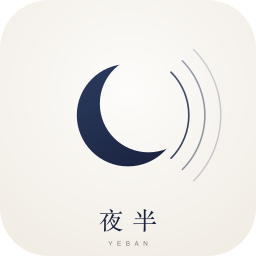
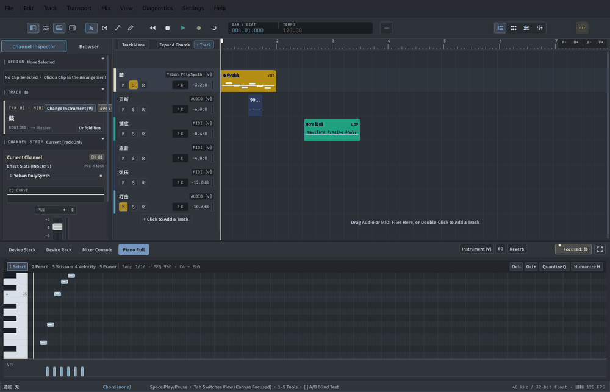

<p align="center">
  <picture>
    <source media="(prefers-color-scheme: dark)" srcset="assets/brand/png/yeban-dark-256.png">
    <source media="(prefers-color-scheme: light)" srcset="assets/brand/png/yeban-light-256.png">
    
  </picture>
</p>

<p align="center">
  <strong>简体中文</strong> · <a href="README.md">English</a>
  &nbsp;|&nbsp;
  <a href="https://yeban.wangda.today">官网</a> ·
  <a href="docs/README.md">文档索引</a>
</p>

---

# 夜半 (Yeban) — 专业桌面 DAW

夜半是用 Rust 编写的开源数字音频工作站：Slint 原生界面 + 纯 Rust 低时延实时音频引擎。带有完整的 MCP 工具面，AI agent 可以通过它作曲、编曲和混音，与人一起在桌面 GUI 前并肩创作。

**许可证**：GNU General Public License v3.0 (GPLv3)，附 GPLv3 §7 允许的 CLAP 专有插件加载例外。见[法律](#法律)。

## 下载

以下安装包来自持续滚动的 **nightly** 构建（跟踪 `main` 分支；未签名）：

| 平台 | 安装包 |
| :--- | :--- |
| Windows (x86_64) | [MSI 安装包](https://github.com/gradetwo/yeban/releases/download/nightly/yeban-0.0.1-x86_64-pc-windows-msvc.msi) |
| macOS (Apple Silicon) | [DMG 镜像](https://github.com/gradetwo/yeban/releases/download/nightly/yeban-0.0.1-aarch64-apple-darwin.dmg) |
| macOS (Intel) | [DMG 镜像](https://github.com/gradetwo/yeban/releases/download/nightly/yeban-0.0.1-x86_64-apple-darwin.dmg) |
| Linux (x86_64) | [DEB 安装包](https://github.com/gradetwo/yeban/releases/download/nightly/yeban-0.0.1-x86_64-unknown-linux-gnu.deb) |
| Linux (arm64) | [DEB 安装包](https://github.com/gradetwo/yeban/releases/download/nightly/yeban-0.0.1-aarch64-unknown-linux-gnu.deb) |

便携版 `.tar.gz` 压缩包与 `SHA256SUMS` 见 [nightly 发布页](https://github.com/gradetwo/yeban/releases/tag/nightly)；全部版本见 [Releases](https://github.com/gradetwo/yeban/releases)。

## 界面截图

当前界面，打开内置演示工程（鼓、贝斯、铺底、主音、弦乐、打击乐）：

[](https://yeban.wangda.today/#interface)

## 强大功能

- **Songmap 整曲总览图**（`get_song_overview` MCP 工具，或 CLI `--export-song-overview`）：一幅小节级四层诊断图——能量、频率、疏密、情绪——附自动异常诊断、段落期望包络带、3 档流派预设（`default` / `orchestral` / `electronic`）、谱面力度虚线、A/B 快照对比（`compare_song_snapshots` MCP 工具）与段内自相似度检查。
- **命令行母带**：`--loudness-target` 配 `--true-peak-ceiling`，在 `--export-wav` 上应用响度目标；目标达不到就响亮失败，绝不静默降级。
- **批量操作与分轨**：`--apply-ops` 把一文件编曲操作一次提交；`--export-stems` 分轨导出，与 MCP 工具同一后端。
- **采样库编辑器**：`--edit-samples` 把每个采样的音准校到 ±0.5 音分以内（FFT 基频），合成 mf/f 力度层并做 RMS 归一化。
- **音频切片器**：`--slice-audio` 检测起音、按音节切分、变调 / 变速 / 磁带变速，写出 SFZ 采样区。
- **歌词轨**：`--export-lyrics` 把歌词时间轴存进工程，导出 LRC。
- **工程自带一切**：用到的采样与 SFZ 定义内嵌进 `.yeban` 容器；渲染先查容器内嵌、再查磁盘；旧工程渲染不变。
- **原生预制**：4 个 MCP 工具（`yeban_list_presets`、`yeban_apply_preset`、`yeban_save_preset`、`yeban_preset_bypass`）与 6 个工厂预制（钢琴、大提琴、古典吉他、长笛、萨克斯、鼓组），载入即带调好的处理，不是干声。
- **歌声合成（经外部 SVS 服务）**：`synthesize_singing` 提交谱子、`svs_job` 取回结果——夜半是 MCP 客户端，合成在伶人 SVS 服务侧进行。
- **46 个 MCP 工具**（意图 API v2）与 **VST3 插件宿主**（进程内；跨进程隔离为二期）。

## 状态与平台支持

夜半在积极开发中。引擎确定性地渲染音频；主窗口启动时用的仍是演示工程；尚无 MPE。路线图见 [docs/YEBAN_ENGINEERING_IMPLEMENTATION_ROADMAP.md](docs/YEBAN_ENGINEERING_IMPLEMENTATION_ROADMAP.md)。

macOS、Linux 与 Windows 均有完整测试。UI 层面还在完善。

### Windows 控制台编码

夜半的命令行输出是 UTF-8。Windows 控制台的缺省代码页会把这些输出显示为乱码，运行夜半命令前先在控制台里执行 `chcp 65001`，把代码页切换到 UTF-8。

## 从源码构建

需要 Rust 1.99.0（由 [`rust-toolchain.toml`](rust-toolchain.toml) 钉死，`rustup` 会自动安装）、C++ 编译器与 `libclang`（`yeban-dsp` 构建时用 `bindgen` 生成绑定）。

**Linux (Debian/Ubuntu)**

```bash
sudo apt-get install -y clang libclang-dev pkg-config libfontconfig1-dev libfreetype-dev libxkbcommon-dev libxkbcommon-x11-0 libwayland-dev libx11-dev libgl1-mesa-dev libasound2-dev
git clone https://github.com/gradetwo/yeban.git
cd yeban
cargo build --release -p yeban-app
```

**macOS**

```bash
xcode-select --install
git clone https://github.com/gradetwo/yeban.git
cd yeban
cargo build --release -p yeban-app
```

**Windows**

安装 LLVM，并把 `LIBCLANG_PATH` 指向含 `libclang.dll` 的目录，然后：

```bat
git clone https://github.com/gradetwo/yeban.git
cd yeban
cargo build --release -p yeban-app
```

运行：`cargo run --release -p yeban-app`（无显示器的机器加 `-- --headless`）。内存吃紧的机器改用 `cargo build --profile release-small -p yeban-app`。完整命令行参考（`--help` 列全部开关与退出码）、MCP 服务形态与开发工作流见[文档索引](docs/README.md)。

## 用夜半创作的作品

**[《慢性崩溃环 THE CHRONIC MOBIUS》](https://trilogy.wangda.today)**——用夜半创作的三部曲作品。三章——I. 雨声太吵、II. 失语呢喃、III. 潮·失——组成一个沉浸式视觉体验，点击拓扑节点跃迁情绪相位。

▶ 试听《雨声太吵》（4 分 24 秒，[直接播放](https://trilogy.wangda.today/assets/05-yushengtaichao.mp3)）——完整体验在[三部曲站](https://trilogy.wangda.today)，视觉配合音乐。

## 法律

| 文件 | 内容 |
| :--- | :--- |
| [`LICENSE`](LICENSE) | GNU GPLv3 完整文本，附 GPLv3 §7 的 CLAP 插件加载例外 |
| [`LEGAL.md`](LEGAL.md) | 第三方商标声明、Slint 双轨授权、VST3 SDK MIT 路径、资产政策 |
| [`TRADEMARK.md`](TRADEMARK.md) | “夜半 / Yeban”商标使用指南 |
| [`CONTRIBUTING.md`](CONTRIBUTING.md) | 参与开发（DCO 1.1、代码风格、GPLv3 源码分发规则） |
| [`SECURITY.md`](SECURITY.md) | 漏洞报告通道 |
| [`THIRD_PARTY_LICENSES.md`](THIRD_PARTY_LICENSES.md) | 第三方依赖与资产许可审计，及源码级移植出处 |

基于本项目 Fork 并闭源分发，须自行向 SixtyFPS GmbH 获取 Slint 商业许可（见 [`LEGAL.md`](LEGAL.md)）。

## 出处与致谢

夜半不重复造已有的轮子。最大的一处复用是约 8,000 行无依赖、零分配、带单元测试的 MIT Rust DSP 代码，来自一个更早的本地项目（`synth-core`），已移植进 `yeban-dsp`，逐文件出处记在 [`docs/ledger/dsp-core-provenance.md`](docs/ledger/dsp-core-provenance.md)，致谢记在 [`THIRD_PARTY_LICENSES.md`](THIRD_PARTY_LICENSES.md) §3。

原生模态共振器核心（`yeban-dsp::modal`）参照 tiagolr 的 [RipplerX](https://github.com/tiagolr/ripplerx) 算法（GPL-3.0，与夜半同协议；未移植 JUCE 框架代码），其谱系经 Rippler2 上溯到 [Saike's Partials](https://github.com/JoepVanlier/JSFX)（MIT）。双共振器级采用两只弹簧耦合振子的简正频率、并联拓扑；公式与 [MechanOdd](https://github.com/odoare/MechanOdd) 的数学部分交叉核对（仅数学——其代码许可未声明，未取代码）。逐模型出处、参数、验收判据与完整选型审计见 [`docs/ledger/modal-synth.md`](docs/ledger/modal-synth.md)。

完整复用审计见 [`docs/ledger/legacy-reuse-audit.md`](docs/ledger/legacy-reuse-audit.md)。

---

<p align="center">
  <sub>夜半 (Yeban) — GPLv3 · <a href="https://yeban.wangda.today">yeban.wangda.today</a> · <a href="mailto:yeban@wangda.today">yeban@wangda.today</a></sub>
</p>
